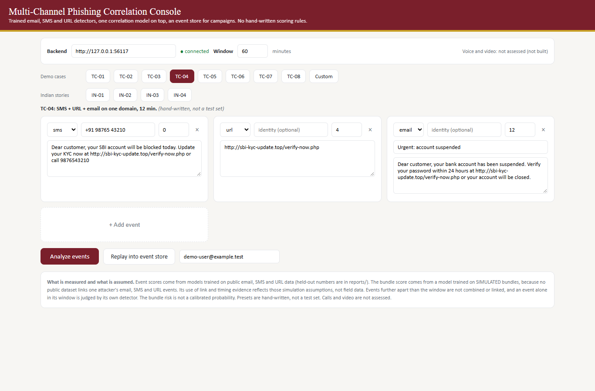
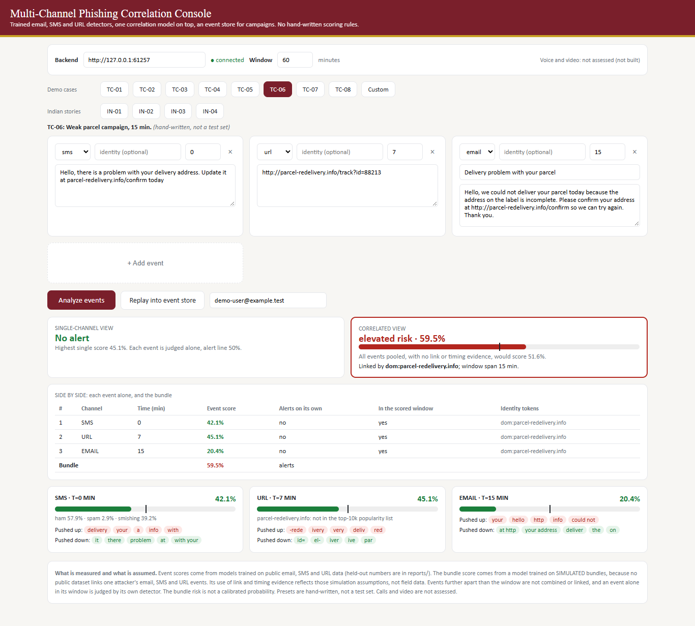
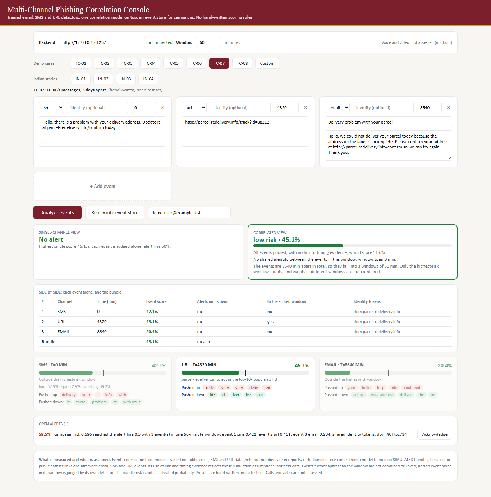
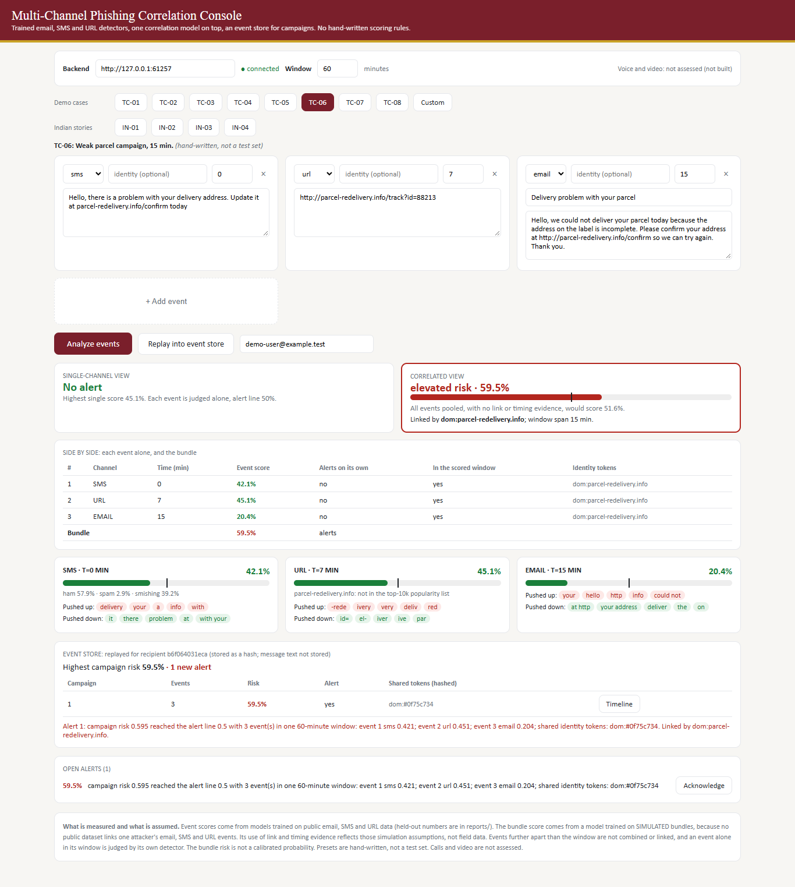
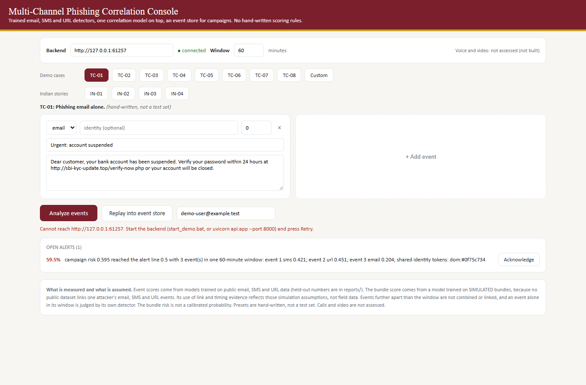

# User manual: the CP1 phishing correlation console (R3-21)

This manual walks through the console view by view. Install and start-up are in `README.md`; numbers are in `reports/FINAL_NUMBERS.md`.
The screenshots come from `scripts/ui_checks.py`, which drives the real console in Chrome and Edge, so they show exactly what the build does.

## 1. Start it

1. Windows: double-click `start_demo.bat` in the project folder. Linux or macOS: `.venv/bin/python scripts/preflight.py --keep-running --open`.
2. Wait for **GO**. Preflight checks Python, the packages, the model files and the console, starts the API, runs the eight demo cases and checks
   that nothing needs the network. The browser opens http://127.0.0.1:8000/ by itself.
3. If you see **NO-GO**, read the line marked `NO` and the Troubleshooting table in `README.md`.

## 2. The top bar

- **Backend**: the API address. When the console is served by the API (the normal case) it is the page's own address; leave it.
- **● connected / ● degraded / ● not reachable**: what `/health` says. *Degraded* names a channel whose model file is missing; its events read
  "not assessed" until it is restored. *Not reachable* shows a **Retry** button.
- **Window**: minutes. Events further apart than this are not combined or linked. It starts at the value the API reports (60).
- **Voice and video: not assessed (not built)**: there is no voice or video detector in CP1.

## 3. Presets

- **Demo cases TC-01 to TC-08** and **Indian stories IN-01 to IN-04** load hand-written events. They are *not a test set*: they show how the system
  behaves, and no rate is ever computed from them.
- **Custom** clears the editor so you can type your own events.
- The line under the buttons says what the preset is.

## 4. Editing events

Each card is one event:

- **channel**: email, sms, url, call or video. Call and video show an amber note: they are stored and shown, never scored.
- **identity** (optional): a sender number, address or domain. Phone numbers, domains and this field become identity tokens.
- **time**: minutes (or an ISO date-time). Only differences matter.
- **subject** (email only) and the **text** (the message, or the URL).
- **×** removes the event; **+ Add event** adds one (up to six).

## 5. Analyze events

Press **Analyze events**. The console sends the events to `POST /correlate` and shows:

- **Single-channel view**: does any event alert on its own (score at or above 50%)?
- **Correlated view**: the bundle risk and label, the score all events would get pooled with no link or timing evidence, the shared identity
  tokens, and, when the events span more than one window, how many windows there are. *CANNOT_ASSESS* means no event could be scored (for example
  only a call); it is never a "safe" verdict.
- **Side by side**: one row per event (channel, time, score or "not assessed", alerts on its own, in the scored window, identity tokens) and a
  final row with the bundle risk.
- **One card per event**: the score bar with the alert line, SMS class probabilities, the URL's domain popularity, and the words or character
  groups that pushed the score up or down.

TC-07 is the same three messages spread over three days. They fall into three windows, nothing is linked, and the bundle risk is the strongest
single event:

## 6. Replay into the event store

Type a recipient (any label; it is stored only as a hash) and press **Replay into event store**. The console sends the events to `POST /events`:

- **Highest campaign risk** for that recipient, and how many **new alerts** were raised.
- **Campaign table**: each campaign (one time window of the recipient's events), its number of events, risk, whether it alerts, and the shared
  tokens shown as hashes (`dom:#84110732`).
- **Timeline**: every event of the recipient in that window, including calls and video, with "not part of the score" where it applies.
- **Open alerts** at the bottom, each with its reason (which events and which shared tokens) and an **Acknowledge** button.

Each replay uses a fresh recipient, so replays do not mix.

## 7. When the API stops

If the API stops, **Analyze** shows "Cannot reach ..." with what to do. Start the API again (`start_demo.bat`) and press **Retry** or **Analyze**;
the page keeps working meanwhile.

## 8. What the console never does

- It does not score anything itself: every number comes from the API.
- It does not call the internet; `scripts/offline_check.py` and the UI checks verify this.
- It does not store anything in the browser.

## 9. Other views

- http://127.0.0.1:8000/lite is the one-file console (`console.html`) with fewer views.
- `GET /campaigns`, `GET /alerts` and the other routes are listed in `README.md`.
