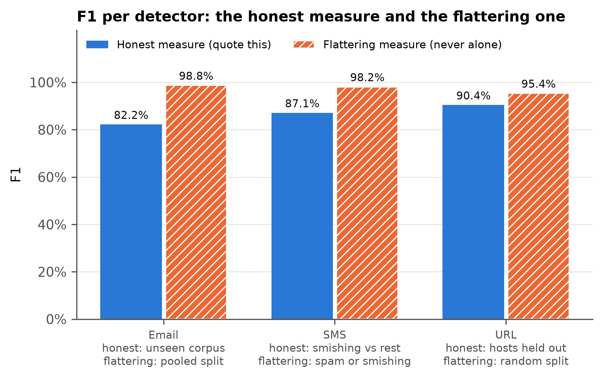
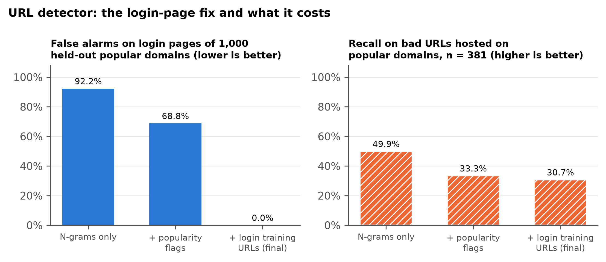
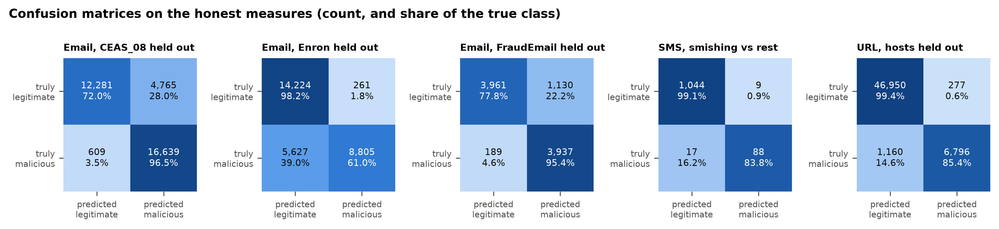
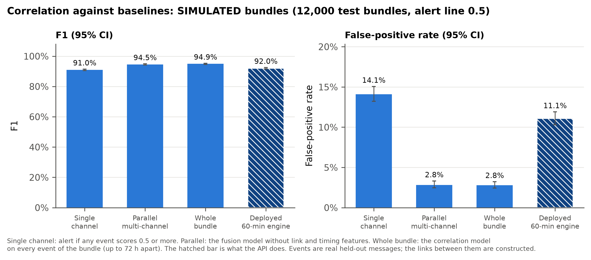
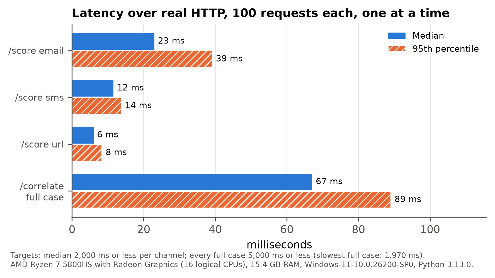

# Chapter 4. Results and discussion

> Generated by `scripts/render_docs.py` from `reports/final_numbers.json` (build `cp1-final`, commit `18ba1d9`). Edit `docs/templates/report/04_results_discussion.md`, not this file. Every number comes from the reports; none is typed.

All numbers are from build `cp1-final` (`reports/FINAL_NUMBERS.md`). Correlation results are on simulated bundles.

## 4.1 Detectors

| Detector | Measure | Precision | Recall | F1 | False-positive rate |
|---|---|---|---|---|---|
| Email | Honest: CEAS_08 held out | 77.7% | 96.5% | 86.1% | 28.0% |
| Email | Honest: Enron held out | 97.1% | 61.0% | 74.9% | 1.8% |
| Email | Honest: FraudEmail held out | 77.7% | 95.4% | 85.7% | 22.2% |
| Email | **Honest: mean of the 3 held-out runs** | see rows above | see rows above | **82.2%** | see rows above |
| Email | Flattering: pooled random split | 98.7% | 98.8% | 98.8% | 1.3% |
| SMS | Honest: smishing vs rest | 90.7% | 83.8% | **87.1%** (95% CI 82.3%-91.7%) | 0.9% |
| SMS | Flattering: spam or smishing vs ham | 99.5% | 96.9% | 98.2% | 0.1% |
| URL | Honest: hosts held out | 96.1% | 85.4% | **90.4%** (95% CI 90.0%-90.9%) | 0.6% |
| URL | Flattering: feature benchmark, random split | 95.4% | 95.4% | 95.4% | 2.5% |

**Email.** The honest figure is the mean F1 of three leave-one-corpus-out runs: 82.2%, against 98.8% on a pooled
random split. The gap is the corpus style that a random split rewards. On unseen corpora the false-positive rate ranges from
1.8% to 28.0%: the threshold does not transfer. On 4,069 real legitimate emails of one consenting user, the live
model raised a false alarm on 23.5%. 3 attempts to retrain with more data were made under a rule
fixed in advance; none passed, so v2's model stays.

**SMS.** Smishing against everything else: F1 87.1% (95% CI 82.3%-91.7%). The interval is wide because only
105 test messages are smishing.

**URL.** With hosts held out, F1 90.4%. The login-page fix took false alarms on popular login pages from
92.2% to 0.0%, and recall on bad URLs on popular domains from 49.9% to
30.7%.

## 4.2 Correlation (simulated bundles)

| Method (SIMULATED bundles, alert line 0.5) | Precision | Recall | F1 (95% CI) | False-positive rate (95% CI) |
|---|---|---|---|---|
| Single-channel: alert if any event reaches the line | 87.0% | 95.3% | 91.0% (90.4%-91.4%) | 14.1% (13.2%-15.1%) |
| Parallel multi-channel: fusion without link and timing features | 97.0% | 92.2% | 94.5% (94.2%-94.9%) | 2.8% (2.5%-3.3%) |
| Correlation model on the whole bundle | 97.0% | 92.9% | 94.9% (94.6%-95.3%) | 2.8% (2.5%-3.2%) |
| Deployed engine, 60-minute windows (what the API does) | 89.4% | 94.9% | 92.0% (91.5%-92.5%) | 11.1% (10.3%-11.9%) |

On simulated bundles the deployed engine beats single-channel alerting by a little, mostly through fewer false alarms. The same model
without link and timing features is almost as good, so most of the gain comes from combining scores (ROC-AUC 0.9746,
0.9847, 0.9874). The window costs score on this simulation, because the simulation labels unlinked bundles as a
whole; we keep it as the cautious choice. Only 27 simulated linked attacks (0.8%) are missed by every
single-channel filter, and the engine flags 18.5% of them. These numbers describe the simulation, not field
performance.

## 4.3 Demo cases (hand-written, not a test set)

| Case | What it is | Channels | Event scores | Alerts alone? | Bundle risk | Outcome |
|---|---|---|---|---|---|---|
| TC-01 | Phishing email alone | email | 0.998 | yes | 0.998 | alert |
| TC-02 | Smishing SMS alone | sms | 1.000 | yes | 1.000 | alert |
| TC-03 | Voice call (not assessed: no voice detector) | call | not assessed | not assessed | CANNOT_ASSESS | not assessed |
| TC-04 | SMS + URL + email on one domain, 12 min | sms, url, email | 1.000 / 0.995 / 0.998 | yes | 1.000 | alert |
| TC-05 | A colleague shares an article, 10 min | sms, email, url | 0.002 / 0.000 / 0.000 | no | 0.000 | no alert |
| TC-06 | Weak parcel campaign, 15 min | sms, url, email | 0.421 / 0.451 / 0.204 | no | 0.595 | alert |
| TC-07 | TC-06's messages, 3 days apart | sms, url, email | 0.421 / 0.451 / 0.204 | no | 0.451 | no alert |
| TC-08 | Courier SMS + email sharing a tracking number | sms, email | 0.970 / 0.031 | yes | 1.000 | alert |
| IN-01 | KYC freeze (SMS, link, call) | sms, url, call | 1.000 / 0.927 / not assessed | yes | 1.000 | alert |
| IN-02 | Courier customs fee (SMS, email, link) | sms, email, url | 0.927 / 0.437 / 0.988 | yes | 1.000 | alert |
| IN-03 | Work-from-home task scam (SMS, email) | sms, email | 0.736 / 0.479 | yes | 0.999 | alert |
| IN-04 | Legitimate order (should stay quiet) | sms, email, url | 0.412 / 0.400 / 0.005 | no | 0.053 | no alert |

TC-06 is the one case where the bundle alerts and no single event does. It is near the line: a retrain on almost the same simulated data moved
it from 0.595 to 0.456. TC-08 shows that a detector false positive (the courier SMS) stays a false
positive after correlation.

## 4.4 Speed

Median 23 ms per email, 12 ms per SMS, 6 ms per URL and 67 ms per full
case, over real HTTP on the build laptop.

## 4.5 Discussion

The detectors are standard methods; what this work adds is the honest evaluation and the engine around them. Reporting the honest split
beside the flattering one changes the story for email most of all. The correlation engine is built and tested end to end, but its value can
only be judged on real coordinated bundles; on simulated ones it helps a little, and its verdict on borderline cases is not stable under
retraining.
